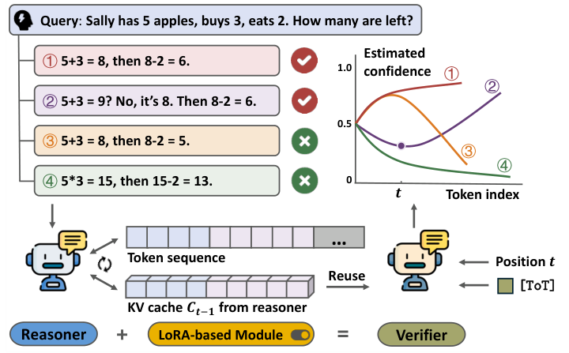

<h1 align="center">One-Token Verification for<br>Reasoning Correctness Estimation</h1>

<p align="center">
  <a href="https://aclanthology.org/people/zhan-zhuang/">Zhan Zhuang</a><sup>1,2</sup>,
  <a href="https://aclanthology.org/people/xiequn-wang/">Xiequn Wang</a><sup>1</sup>,
  <a href="https://aclanthology.org/people/zebin-chen/">Zebin Chen</a><sup>1</sup>,
  <a href="https://aclanthology.org/people/feiyang-ye-4519/">Feiyang Ye</a><sup>1</sup>,<br>
  <a href="https://aclanthology.org/people/ying-wei/">Ying Wei</a><sup>3,†</sup>,
  <a href="https://aclanthology.org/people/kede-ma/">Kede Ma</a><sup>2,†</sup>,
  <a href="https://aclanthology.org/people/yu-zhang-4835/">Yu Zhang</a><sup>1,†</sup>
</p>

<p align="center">
  <sup>1</sup>Southern University of Science and Technology<br>
  <sup>2</sup>City University of Hong Kong &nbsp; <sup>3</sup>Zhejiang University<br>
  <sup>†</sup>Corresponding authors
</p>

<p align="center"><b>EMNLP 2026</b><br><em>Read the reasoning cache. Estimate correctness with one verification token.</em></p>

<p align="center">
  <a href="https://aclanthology.org/2026.emnlp-main.519/"></a>
  <a href="https://arxiv.org/abs/2603.01025"></a>
  <a href="docs/index.html?raw=1"></a>
  <a href="notebooks/otv_quickstart.ipynb"></a>
</p>

## Overview

OTV estimates whether a reasoning prefix will lead to a correct answer. A learned verification token reads the frozen reasoner's KV cache through LoRA adapters, and a small regression head produces a correctness score. See the [paper](https://aclanthology.org/2026.emnlp-main.519/) for the method and experiments.

<p align="center"></p>
<p align="center"><sub>Figure 1 from the paper. Confidence curves are conceptual illustrations.</sub></p>

- **Reuse reasoning states:** prefill once with adapters disabled; keep the resulting K/V tensors detached.
- **Train a verifier:** enable LoRA for verification queries and learn the truth embedding and regression head.
- **Verify prefixes in parallel:** each probe attends to its cached prefix and its own new, LoRA-adapted K/V pair. Other probes and future reasoning tokens are masked out.

## News

- **October 2026:** OTV is published in the main proceedings of EMNLP 2026.
- The repository now includes a standalone implementation and an executable CPU notebook alongside the original LLaMA-Factory integration.

## Installation

Use Python 3.11 or newer in a dedicated environment:

```bash
git clone https://github.com/Multimedia-Analytics-Laboratory/OTV.git
cd OTV
python3.11 -m venv .venv
source .venv/bin/activate
python -m pip install -e .
```

The standalone package uses PyTorch, Transformers, and PEFT. It supports full-attention **Qwen3, Qwen2/Qwen2.5, and Llama** models on CPU or one CUDA device. Transformers and PEFT versions are pinned in `pyproject.toml`. Eager attention accepts the explicit cache-plus-diagonal mask; `--probe-chunk-size` limits the number of verification queries processed together.

### Start with the notebook

```bash
python -m pip install -e ".[notebook]"
jupyter lab notebooks/otv_quickstart.ipynb
```

The [notebook](notebooks/otv_quickstart.ipynb) runs a tiny, randomly initialized Qwen3 model on CPU without downloading model weights. It demonstrates cache reuse, parallel verification, training, scoring, and checkpoint loading. The toy scores illustrate the mechanics; meaningful correctness estimates require training on real labeled traces.

## Training

### 1. Prepare reasoning traces

Use JSONL with a prompt, a complete response, and its final correctness label:

```json
{"question": "What is 1 + 1?", "response": "1 + 1 = 2. Final answer: 2.", "correct": 1}
{"question": "What is 1 + 1?", "response": "1 + 1 = 3. Final answer: 3.", "correct": 0}
```

[`examples/traces.example.jsonl`](examples/traces.example.jsonl) contains synthetic format examples. Use a task-appropriate validator to label real responses. Keep held-out questions separate from training questions.

The standalone loader uses the model's chat template when available, appends the response and EOS, and right-pads batches. Choose `--prompt-format plain` for the explicit `Question: ...\nResponse: ...` format. Match this setting when scoring. Traces exceeding `--max-length` raise an error so completed responses are not silently truncated.

### 2. Choose the reasoner and train

Use the same base model and prompt format that generated the traces. A local model directory or a Hugging Face model ID can be passed to `--model`.

```bash
otv-train \
  --model /path/to/base-model \
  --train-data /path/to/train_traces.jsonl \
  --eval-data /path/to/heldout_traces.jsonl \
  --output outputs/otv_run \
  --device cuda:0 \
  --dtype bfloat16 \
  --epochs 3 \
  --batch-size 1 \
  --gradient-accumulation 8 \
  --probe-chunk-size 128 \
  --max-length 4096 \
  --target-mode linear
```

Omit `--eval-data` when no validation split is available. Use `--device cpu --dtype float32` for small CPU runs. `python -m otv.train` and `python -m otv.score` are equivalent module entry points.

The default objective is MSE against outcome-derived prefix targets. Only the LoRA parameters, truth embedding, and regression head are updated. Supported target rules are `linear`, `constant`, `sigmoid`, `exponential`, `wave`, `step`, and `sine`; `sine` is an additional exploratory option, not a reported paper result.

### 3. Inspect saved outputs

The output directory contains the final checkpoint, `training_args.json`, and `metrics.jsonl`. Intermediate checkpoints are saved every `--save-steps` optimizer updates. With validation data, held-out prefix MSE is recorded every `--eval-steps` updates and at each epoch or run end; the default interval is 200.

| File | Contents |
| --- | --- |
| `adapter_model.safetensors`, `adapter_config.json` | Verification LoRA parameters and configuration |
| `otv_head.safetensors` | Learned truth embedding and regression head |
| `otv_config.json` | Standalone format version, base model reference, and head configuration |
| Tokenizer files | Tokenization used for this run |

Base model weights are loaded separately. Training starts a new run; optimizer resume and distributed training are not implemented in the standalone entry point.

## Quick Inference

After training, score complete traces or partial responses with your standalone checkpoint:

```bash
otv-score \
  --checkpoint outputs/otv_run \
  --input examples/traces.example.jsonl \
  --output results/scores.jsonl \
  --device cuda:0 \
  --probe-chunk-size 128
```

Output preserves the input fields and adds `prefix_scores`, `response_tokens_seen`, `final_score`, and `trace_score`. The trace score averages the last 100 response-prefix scores by default; change this with `--tail-tokens`. Token counts include an appended EOS. Override `--model` if the recorded base model path has moved, and keep the original model weights and tokenizer consistent.

For direct Python use:

```python
from transformers import AutoTokenizer
from otv import OTVVerifier
from otv.score import score_trace

checkpoint = "outputs/otv_run"
verifier = OTVVerifier.from_pretrained(checkpoint=checkpoint).eval()
tokenizer = AutoTokenizer.from_pretrained(checkpoint)
result = score_trace(verifier, tokenizer, "What is 1 + 1?", "1 + 1 = 2.")
print(result["trace_score"])
```

### Standalone and original implementations

The standalone version implements the cache-probing method with standard model forwards. It uses an explicit boundary convention: progress is zero before the response and one at its end, with both boundaries supervised. Its trainable truth embedding, boundary indexing, and checkpoint format differ from the original trainer. **Checkpoints are not interchangeable, and this version has not been benchmarked against the paper's full experiments.**

The original patch-based pipeline, hidden-state baseline, and checkpoint evaluation remain available in the [LLaMA-Factory integration guide](docs/legacy.md). Use that environment and format for existing patch-based runs.

## Testing

```bash
python -m pip install -e ".[test]"
python -m pytest
```

Tests use local random models, with no weight downloads. They check parallel versus independent probes across Qwen3/Qwen2/Llama, causal masking, padding, cache immutability, chunked gradients, frozen base weights, and end-to-end training, scoring, and checkpoint loading. The notebook can be run from top to bottom on CPU. Full-scale CUDA training and benchmark reproduction require the actual model weights and data.

## Blog

[**OTV Blog Download**](docs/index.html?raw=1) — download the HTML file and open it locally. The article, interactive figures, images, styles, scripts, and citation are embedded in one file.

## Acknowledgments

The implementation builds on [Transformers](https://github.com/huggingface/transformers), [PEFT](https://github.com/huggingface/peft), and [LLaMA-Factory](https://github.com/hiyouga/LlamaFactory). The upstream-derived patch retains its source headers and [Apache-2.0 license](patches/LICENSE).

For questions about the code, please open a [GitHub issue](https://github.com/Multimedia-Analytics-Laboratory/OTV/issues).

## Citation

```bibtex
@inproceedings{zhuang-etal-2026-one,
  title = {One-Token Verification for Reasoning Correctness Estimation},
  author = {Zhuang, Zhan and Wang, Xiequn and Chen, Zebin and
            Ye, Feiyang and Wei, Ying and Ma, Kede and Zhang, Yu},
  editor = {Lee, Hung-Yi and Dev, Sunipa and Li, Junyi Jessy and Elliott, Desmond},
  booktitle = {Proceedings of the 2026 Conference on Empirical Methods in Natural Language Processing},
  month = oct,
  year = {2026},
  address = {Budapest, Hungary},
  publisher = {Association for Computational Linguistics},
  url = {https://aclanthology.org/2026.emnlp-main.519/},
  doi = {10.18653/2026.emnlp-main.519},
  pages = {11906--11930},
  ISBN = {979-8-89176-459-0}
}
```
